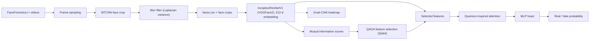

# Quantum-Hybrid Deepfake Detection

Face-level deepfake detection on FaceForensics++ with a classical InceptionResNetV1 backbone, QAOA-based feature selection and a quantum-inspired attention layer.

[](https://doi.org/10.1109/ACCESS.2026.3659021)


Code for the paper *A Quantum-Hybrid Framework for Enhanced Deepfake Detection: Integrating QAOA-Based Feature Selection with Quantum-Inspired Attention Mechanisms* (IEEE Access, 2026).

## Overview

The detector works on individual face crops taken from video frames, not on full videos or high-resolution synthetic images.

1. **Face dataset**: frames are sampled from FaceForensics++ real and manipulated sequences, faces are cropped with MTCNN, and blurry crops are dropped using variance of the Laplacian.
2. **Backbone**: InceptionResNetV1 pretrained on VGGFace2 produces a 512-d embedding per face.
3. **QAOA feature selection**: mutual information between each embedding dimension and the label defines a cost Hamiltonian (`SparsePauliOp`), which Qiskit's `QAOA` (COBYLA optimizer) minimizes to pick a feature subset. The implementation falls back to classical top-k mutual information selection when the feature count is too large to simulate.
4. **Quantum-inspired attention**: learnable real and imaginary amplitudes reweight features by their normalized probability, then scaled dot-product attention with a residual connection.
5. **Head**: an MLP classifier outputs a single real/fake logit, trained with BCE plus a variance-based uncertainty regularizer.

Grad-CAM over the backbone's last block is used to visualize which facial regions drive a prediction.

## Architecture



## Results

From the published paper, evaluated on FaceForensics++:

| Metric | Quantum-hybrid vs. classical baselines |
| --- | --- |
| Accuracy | +2.5 points |
| Calibration error | 45% lower |

See the paper for the full experimental setup, baselines and ablations.

## Repository structure

```
.
├── dataset/
│   ├── download.py               # FaceForensics++ download script
│   ├── create_face_dataset.ipynb # frame sampling + MTCNN face crops + faces.csv
│   ├── blur_detection.py         # drops blurry crops (variance of Laplacian)
│   ├── faces.py                  # FaceDataset (PyTorch Dataset over faces.csv)
│   └── constants.py
├── models/
│   ├── cnn.py                    # HybridCNN: small CNN + Qiskit EstimatorQNN layer
│   └── *.pth                     # checkpoints (Git LFS)
├── utils/                        # accuracy metric, image denormalization, config helper
├── examples/                     # sample real and fake frames for the demo
├── training.py                   # classical InceptionResNetV1 baseline training
├── training.ipynb                # notebook version of the baseline training
├── interpy.py                    # Gradio demo with Grad-CAM
├── inference-gradio.ipynb        # notebook version of the demo
└── requirements.txt
```

The QAOA feature selector, quantum-inspired attention and the full hybrid training loop (`models/quantum_cnn.py`, `qtraining.py`, `interquantum.py`) live on the [`hybrid`](https://github.com/fakubwoy/QuantDeepfakeDetection/tree/hybrid) branch.

## Setup

```sh
git clone https://github.com/fakubwoy/QuantDeepfakeDetection.git
cd QuantDeepfakeDetection

conda create -n deepfake_env python=3.8
conda activate deepfake_env
pip install -r requirements.txt
pip install pandas scikit-learn wandb qiskit qiskit-machine-learning qiskit-algorithms
```

`requirements.txt` covers the classical pipeline and demo. The extra packages are needed by `training.py` (pandas, scikit-learn, wandb) and by the quantum models (Qiskit).

Model checkpoints are stored with Git LFS:

```sh
git lfs install
git lfs pull
```

## Usage

**1. Download FaceForensics++** (requires accepting the dataset's terms of use):

```sh
python3 dataset/download.py data -c c40 -d DeepFakeDetection --server EU2
python3 dataset/download.py data -c c40 -d DeepFakeDetection_original --server EU2
```

**2. Build the face dataset**: run `dataset/create_face_dataset.ipynb`, which writes crops and `data/faces/faces.csv`. Optionally remove blurry crops:

```sh
python3 dataset/blur_detection.py data/faces/<folder>
```

**3. Train the classical baseline** (InceptionResNetV1, 15 epochs, logs to Weights & Biases, saves the best checkpoint to `models/best_resnetinceptionv1.pth`):

```sh
python training.py
```

**4. Train the quantum-hybrid model** (on the `hybrid` branch):

```sh
git checkout hybrid
python qtraining.py
```

**5. Run the demo** (loads `models/resnetinceptionv1_epoch_32.pth`, shows real/fake confidence and a Grad-CAM overlay). That checkpoint is not included in the repo, so train one first with step 3 and save or rename it to that path:

```sh
python interpy.py
```

## Citation

```bibtex
@article{khan2026quantumhybrid,
  author  = {Khan, Farhaan and Sareen, A. and Kumar, A. S. and Bhuvaneswari, M.},
  title   = {A Quantum-Hybrid Framework for Enhanced Deepfake Detection: Integrating {QAOA}-Based Feature Selection with Quantum-Inspired Attention Mechanisms},
  journal = {IEEE Access},
  volume  = {14},
  pages   = {17853--17873},
  year    = {2026},
  doi     = {10.1109/ACCESS.2026.3659021}
}
```

## Authors

Farhaan Khan, A. Sareen, A. S. Kumar, M. Bhuvaneswari
